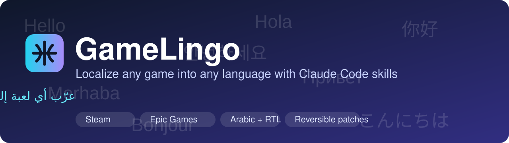
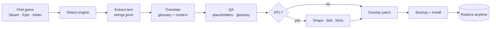

<div align="center">



# GameLingo

**Localize any PC game into any language — with Claude Code skills.**
Scan a game, extract its text, translate it with context, fix right-to-left rendering and fonts, and ship a reversible patch.

[](https://github.com/LechehebDjaafar/gamelingo/actions)
[](LICENSE)
[](#install)
[](#requirements)
[](CONTRIBUTING.md)

[Install](#install) · [Quick start](#quick-start) · [How it works](#how-it-works) · [Engine support](#engine-support) · [Arabic & RTL](#arabic--rtl-first-class) · [Safety](#safety--legal) · [Contribute](#contributing) · [العربية](README.ar.md)

</div>

---

## Why GameLingo?

Millions of players can't enjoy great games because their language isn't supported. Fan translation is a craft that normally needs a reverse-engineer, a translator, a font hacker and a tester. **GameLingo turns that into one conversation with Claude Code.**

> *"Translate the game in `D:\SteamLibrary\steamapps\common\MyGame` into Arabic."*

Claude finds the engine, extracts the strings, translates them with a consistent glossary, makes Arabic render correctly, runs QA, backs up your files and installs the patch. If anything goes wrong: one command restores the original.

## Features

- 🎮 **Steam, Epic Games, GOG & custom folders** — auto-discovers installed games.
- 🔍 **Engine detection** — Unity (Mono/IL2CPP), Unreal, Godot, RPG Maker, Ren'Py, GameMaker, Electron/NW.js.
- 🌍 **Any target language** — Arabic, Persian, Turkish, Spanish, Japanese, Chinese… whatever the user asks for.
- 🧠 **Context-aware translation** — glossary, tone, character voice, UI length limits.
- 🛡️ **Placeholder safety** — `{0}`, `%s`, `<b>`, `\C[2]`, `\N[1]` are protected and verified.
- ↔️ **Real RTL support** — letter shaping, bidi ordering, font plans (Arabic, Persian, Urdu, Hebrew).
- ✅ **Automated QA** — placeholders, glossary, wrong-script output, overflow risk + in-game checklist.
- ♻️ **Non-destructive** — overlay patches, SHA-256 verified backups, one-command restore.
- 🧪 **Tested tooling** — stdlib-only Python helpers with unit tests on Windows, macOS and Linux.

## Install

### Option A — Claude Code plugin marketplace
```text
/plugin marketplace add LechehebDjaafar/gamelingo
/plugin install gamelingo@gamelingo
```

### Option B — install script
```bash
git clone https://github.com/LechehebDjaafar/gamelingo
cd gamelingo
./install.sh            # macOS / Linux
# .\install.ps1         # Windows PowerShell
```

### Option C — manual
Copy every folder inside `skills/` to `~/.claude/skills/` (Windows: `%USERPROFILE%\.claude\skills\`).

### Requirements
- [Claude Code](https://claude.com/claude-code)
- Python 3.10+
- For Arabic / RTL: `python -m pip install -r requirements-rtl.txt`
- Optional engine tools per game (UABEA, repak, GDRE Tools, unrpa, UndertaleModTool…) — see [engine recipes](skills/gamelingo/references/engines/).

## Quick start

Open Claude Code and just describe what you want:

```text
> Translate "Moonlight Courier" into Arabic
> Add Turkish to my Steam game in D:\Games\SomeGame
> What engine does this game use and can it be localized? C:\Program Files\Epic Games\X
> The Arabic text in my patched game shows disconnected letters — fix it
> Undo the translation patch
```

Or call the skills directly:

| Command | What it does |
|---|---|
| `/gamelingo` | Runs the whole pipeline |
| `/gamelingo-scan` | Find the game, detect the engine, map text files |
| `/gamelingo-extract` | Extract text into `strings.jsonl` |
| `/gamelingo-translate` | Translate with glossary and placeholder protection |
| `/gamelingo-rtl` | Shaping, bidi and fonts for RTL / complex scripts |
| `/gamelingo-qa` | Automated checks + in-game checklist |
| `/gamelingo-pack` | Build overlay, back up, install |
| `/gamelingo-restore` | Return the game to its original state |

### Try the demo (no game required)
```bash
S=skills/gamelingo/scripts
python $S/detect_engine.py examples/demo-game
python $S/strings_io.py extract examples/demo-game/data -o /tmp/strings.jsonl \
       --keys name,profile,gameTitle,parameters --min-len 3
python $S/strings_io.py stats /tmp/strings.jsonl
```

## How it works



Claude handles judgment (engine reasoning, translation, glossary, tone). Small, unit-tested scripts handle plumbing (parsing, writing back, hashing, backups). Details: [docs/ARCHITECTURE.md](docs/ARCHITECTURE.md).

## Engine support

Status is deliberately conservative. **Stable** = round-trip covered by automated tests. **Beta** = documented recipe that works with a third-party tool. **Experimental** = needs per-game investigation.

| Engine / format | Status | Text access | Notes |
|---|---|---|---|
| JSON / CSV / PO / `.properties` files | ✅ Stable | built-in `strings_io.py` | Works for any engine that ships plain text tables |
| RPG Maker MV / MZ | 🟢 Beta | JSON in `data/` | No repack needed |
| Electron / NW.js | 🟢 Beta | JSON / locale files, `app.asar` | Chromium shapes Arabic natively |
| Godot | 🟢 Beta | CSV / PO, `.pck` via GDRE Tools | Godot 4 has RTL text server |
| Ren'Py | 🟢 Beta | `game/tl/<lang>/` translate blocks | Built-in translation system |
| Unity (Mono / IL2CPP) | 🟡 Experimental | loose files, localization tables, runtime plugin | Text often inside assets |
| Unreal Engine | 🟡 Experimental | `.locres` + patch `_P.pak` | Needs pak/locres tools |
| GameMaker | 🟡 Experimental | `data.win` via UndertaleModTool | Single-file, back up carefully |

Not supported: games with encrypted/anti-cheat-protected files, text baked into images or audio, online-only titles.
Missing your engine? See [docs/ADDING-ENGINE-SUPPORT.md](docs/ADDING-ENGINE-SUPPORT.md).

## Arabic & RTL: first-class

Correct translations can still look broken in-game: disconnected letters, reversed words, boxes. GameLingo treats this as three separate problems — **shaping, bidi ordering, glyph coverage** — and picks one of three modes per engine:

| Mode | Engine behavior | Action |
|---|---|---|
| `none` | does shaping + bidi | just provide an Arabic font |
| `shape` | bidi only | pre-shape letters |
| `visual` | neither | pre-shape + reorder |

```bash
python skills/gamelingo/scripts/rtl.py text "مرحبا بالعالم" --mode visual
```
Read the [Arabic & RTL guide](skills/gamelingo/references/rtl-arabic.md). The same machinery covers Persian, Urdu and Hebrew, plus font plans for CJK and other scripts.

## Safety & legal

- **Your own copy only**, preferably offline/single-player games.
- **Never in place** — overlay + verified backup + restore.
- **No DRM or anti-cheat bypass.** Games with EasyAntiCheat/BattlEye/Vanguard are flagged; modifying them can get accounts banned.
- **Share only your translation overlay**, never game files or extracted assets. Check each publisher's policy on fan translations.

Full notes: [legal-and-safety.md](skills/gamelingo/references/legal-and-safety.md). Not legal advice.

## Repository layout

```text
gamelingo/
├── .claude-plugin/          plugin + marketplace manifests
├── skills/
│   ├── gamelingo/           orchestrator + scripts/ + references/
│   ├── gamelingo-scan/      find game, detect engine
│   ├── gamelingo-extract/   text → strings.jsonl
│   ├── gamelingo-translate/ context-aware translation
│   ├── gamelingo-rtl/       shaping, bidi, fonts
│   ├── gamelingo-qa/        validation + in-game checklist
│   ├── gamelingo-pack/      overlay, backup, install
│   └── gamelingo-restore/   undo
├── examples/                synthetic demo game, glossary example
├── tests/                   unit tests for every script
├── tools/                   skill validator, release builder
├── docs/                    architecture, FAQ, roadmap, engine guide
└── .github/                 CI, issue and PR templates
```

## Roadmap

Ren'Py `.rpy` handler · XLIFF/`.resx`/`.locres` readers · XUnity.AutoTranslator exporter · shared translation memory · font-coverage checker · screenshot QA · community recipe catalog. See [docs/ROADMAP.md](docs/ROADMAP.md).

## Contributing

Engine recipes, format handlers, RTL knowledge and glossaries are all welcome. Start with [CONTRIBUTING.md](CONTRIBUTING.md) and the [engine guide](docs/ADDING-ENGINE-SUPPORT.md). Good first issues: add a format handler, verify an engine recipe on a real game, improve a glossary.

```bash
make validate test
```

## FAQ

See [docs/FAQ.md](docs/FAQ.md).

## License

[MIT](LICENSE). GameLingo is unofficial and not affiliated with any game publisher, engine vendor, Steam/Valve or Epic Games. Names are trademarks of their owners.

<div align="center">

If GameLingo helped you play a game in your language, **give it a ⭐** and share your recipe.

</div>
